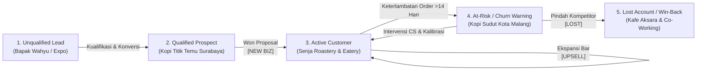

# MATERI KULIAH: ENTERPRISE CRM & ARSITEKTUR SUITECRM 8

> **Informasi Sistem & Versi Instance Terverifikasi:**  
> - **SuiteCRM Core Version:** 8.8.1 (Angular 18 Frontend + Legacy Engine 7.14.7 / SugarCRM 6.5.25 CE)  
> - **Database Server:** MariaDB 10.11.11-debian-12-r11  
> - **PHP CLI/FPM Engine:** PHP 8.1.33  
> - **Studi Kasus Bisnis:** PT Sumber Kopi Nusantara (B2B Specialty Coffee Roaster & Commercial Espresso Machine Distributor, Surabaya - Jawa Timur)  
> - **Status Lingkungan:** Local Educational Demonstration (`bitnamilegacy/suitecrm:8.8.1-debian-12-r3` - Frozen Legacy Image)

---

## 1. Konsep Fundamental: CRM vs. ERP

Dalam mata kuliah Sistem Informasi Perusahaan (*Enterprise Information Systems*), batas arsitektur antara **CRM** (*Customer Relationship Management*) dan **ERP** (*Enterprise Resource Planning*) merupakan fondasi analitis yang krusial.

```
       FRONT-OFFICE (Fokus CRM)                     BACK-OFFICE (Fokus ERP)
 ┌───────────────────────────────────┐        ┌───────────────────────────────────┐
 │ • Lead Acquisition & Kampanye     │        │ • Inventory Control & Batching    │
 │ • Pipeline Penjualan B2B          │ ◄────► │ • Material Requirement Planning   │
 │ • Service Desk, Kasus & Tiket     │        │ • Procurement & Vendor Management │
 │ • Interaksi, Rapat & Komunikasi   │        │ • General Ledger & Akuntansi      │
 └───────────────────────────────────┘        └───────────────────────────────────┘
```

### 1.1 Mengapa SuiteCRM adalah "Pure CRM"?
SuiteCRM berfokus 100% pada **interaksi eksternal pelanggan (*Customer Touchpoints*)**.
- **Scope CRM (Included):** Siklus hidup prospek, riwayat interaksi, penjadwalan demo teknis mesin kopi, pipeline probabilitas transaksi, dan SLA keluhan teknis mesin pelanggan.
- **Scope ERP (Deliberately Excluded):** 
  - Saldo stok gudang green beans & roasted beans
  - Bill of Materials (BOM) perakitan mesin espresso
  - Purchase Order ke petani kopi Ijen / Argopuro
  - Manajemen logistik pengiriman kargo
  - Pembukuan akuntansi debit-kredit dan rekonsiliasi bank

> **Batasan Khusus Modul Quotes (Penawaran):**  
> Pada SuiteCRM, modul *Quotes* hanya berfungsi sebagai **pembuat proposal PDF (*document generator*)** untuk mengunci komitmen harga ke klien, **tanpa** mengurangi stok fisik gudang (*zero stock impact*) dan **tanpa** memotong jurnal persediaan (*zero financial postings*).

---

## 2. Tiga Pilar CRM (The Three CRM Pillars)

Penerapan CRM di PT Sumber Kopi Nusantara mendemonstrasikan ketiga pilar utama CRM:

| Pilar CRM | Definisi & Fungsi Bisnis | Modul SuiteCRM | Bukti Implementasi di Database & Demo |
| :--- | :--- | :--- | :--- |
| **Operasional CRM** | Otomasi proses bisnis *front-office* untuk akuisisi pelanggan dan konversi pendapatan secara terstruktur. | `Campaigns`<br>`Leads`<br>`Opportunities` | - 3 Kampanye Multi-Tahun (2022, 2024, 2026)<br>- Lead *Wahyu Pratama (Kopi Kontainer Sidoarjo)* dikonversi jadi Account<br>- Pipeline 18 Opportunity lintas 5 tahun dengan stage & weighted probability |
| **Kolaboratif CRM** | Sinkronisasi data antar-divisi (Sales, Field Engineer, Customer Success) agar pelanggan mendapat respon terkoordinasi tanpa silo data. | `Accounts`<br>`Contacts`<br>`Cases`<br>`Calls`<br>`Meetings` | - Portofolio 15 Akun B2B beragam (Hotel Bintang 5, Kafe Multi-Cabang, Roastery, Resort, Korporat, RS, Kampus)<br>- Akun veteran 5 tahun (*Grand Majapahit Hotel Surabaya* & *Kopi Titik Temu*) memiliki rekam jejak lengkap BAST 2021-2025, laporan tahunan PMR, dan penanganan tiket servis *[URGENT] Tekanan Steam Wand Turun* |
| **Analitikal CRM** | Analisis performa bisnis, pipeline transaksi, metrik retensi, dan risiko churn melalui representasi visual agregat. | `Dashboards`<br>`Reports` | - Sales Pipeline by Stage Chart (5-Year Historical & Active Funnel)<br>- Won vs Lost Analysis (9 Won vs 3 Lost untuk evaluasi Win-Rate)<br>- Dashlet Overdue Activities (peringatan panggilan tindak lanjut demo tertunda) |

---

## 3. Siklus Hidup Pelanggan B2B (*Customer Lifecycle*)

PT Sumber Kopi Nusantara menerapkan customer journey siklus tertutup (*closed-loop lifecycle*):



### Pemetaan Data Seed ke Customer Lifecycle:
1. **Lead (Tahap Awal):** `Bapak Wahyu` (Kopi Kontainer Sidoarjo) diperoleh dari *Trade Show* F&B Expo Surabaya.
2. **Prospect (Peluang Baru):** `Kopi Titik Temu Surabaya` – Status Prospect, memiliki opportunity `[NEW BIZ] Paket Espresso 2-Group & Biji Kopi` (Stage: *Proposal/Price Quote*, Probabilitas: 65%).
3. **Customer VIP (Pertumbuhan & Retensi):** `Senja Roastery & Eatery` – Status Customer, memiliki deal `[WON] Mesin Aurelia dan Kontrak Kopi` (Rp 85.000.000) dan penawaran ekspansi `[UPSELL] Grinder Single Origin dan Sirup` (Rp 22.000.000).
4. **At-Risk / Churn Alert:** `Kopi Sudut Kota Malang` – Status Customer, mengalami jeda repeat order biji kopi >14 hari. Diintervensi melalui opportunity `[RETENTION] Reaktivasi Kontrak Biji Kopi` dan *Planned Call* yang overdue.
5. **Lost / Win-Back Candidate:** `Kafe Aksara & Co-Working` – Status Customer, namun deal cabang `[LOST] Mesin Espresso Cabang` kalah harga dari distributor mesin rekondisi. Disimpan untuk program win-back semester berikutnya.

**Key Performance Indicators (KPI) Analitikal:**
- **Win Rate:** `Count(Closed Won) / (Count(Closed Won) + Count(Closed Lost))` = `1 / (1 + 1) = 50%`.
- **Pipeline Value:** Total nilai opportunity terbuka = `Rp 68.000.000 + Rp 15.000.000 + Rp 22.000.000 = Rp 105.000.000`.
- **Weighted Pipeline:** `(68jt × 65%) + (15jt × 20%) + (22jt × 10%) = 44,2jt + 3jt + 2,2jt = Rp 49.400.000`.

---

## 4. Arsitektur Perangkat Lunak SuiteCRM 8

SuiteCRM 8 menerapkan arsitektur hybrid modern yang memisahkan lapisan tampilan (*front-end*) dan mesin logika (*back-end*).

```
 ┌──────────────────────────────────────────────────────────────┐
 │                     KLIEN BROWSER                            │
 └──────────────────────────────┬───────────────────────────────┘
                                │ HTTP / JSON
                                ▼
 ┌──────────────────────────────────────────────────────────────┐
 │                  SUITECRM 8 APPLICATION                      │
 │                                                              │
 │   ┌────────────────────────┐      ┌──────────────────────┐   │
 │   │  Angular 18 Frontend   │ ◄──► │  Symfony 6 Core API  │   │
 │   │ (SPA / Module Fed.)    │      │  (GraphQL & REST v8) │   │
 │   └────────────────────────┘      └──────────┬───────────┘   │
 │                                              │               │
 │                   SUITECRM LEGACY ENGINE     ▼               │
 │   ┌──────────────────────────────────────────────────────┐   │
 │   │ • Classic MVC Architecture (include/entryPoint.php)  │   │
 │   │ • SugarBean ORM & Metadata Engine                    │   │
 │   │ • Logic Hook & Workflow Engine                       │   │
 │   └──────────────────────────┬───────────────────────────┘   │
 └──────────────────────────────┼───────────────────────────────┘
                                │ SQL (PDO/mysqli)
                                ▼
 ┌──────────────────────────────────────────────────────────────┐
 │                  MARIADB 10.11 DATABASE                      │
 └──────────────────────────────────────────────────────────────┘
```

### 4.1 Pemisahan Frontend & Backend (*The Architectural Split*)
1. **Frontend (Modern SPA):** Dibangun menggunakan Angular 18 (`/core/app/core`). Menyediakan respons antarmuka cepat, navigasi tanpa reload halaman penuh, dan UI modern.
2. **Backend Engine (Legacy SugarCRM/SuiteCRM 7):** Terletak di folder `public/legacy/`. Menjalankan engine metadata, validasi SugarBean, Logic Hooks, dan kompatibilitas modul kustom.
> **Relevansi CRM-nya:** Arsitektur ini memungkinkan tim sales membuka CRM di perangkat mobile/tablet dengan UI modern yang responsif saat bertemu klien di coffee shop, tanpa kehilangan ribuan modul kustom warisan *enterprise* yang sudah stabil puluhan tahun.

### 4.2 PHP MVC Pattern pada SugarBean
Setiap modul (misal `Opportunities`) memiliki representasi:
- **Model:** `modules/Opportunities/Opportunity.php` turunan dari `SugarBean`. Mengatur relasi, validasi tipe data, dan persistensi SQL.
- **View:** `modules/Opportunities/views/` mengatur rendering form edit, detail, dan listview.
- **Controller:** Mengatur aksi pengguna (*Save, EditView, DetailView, ConvertLead*).
> **Relevansi CRM-nya:** Memisahkan logika kalkulasi probabilitas deal B2B dari tampilan form entri data sales representative di lapangan.

### 4.3 Logic Hooks (`before_save`, `after_save`)
Logic Hook adalah event listener internal SuiteCRM:
- `before_save`: Dijalankan sebelum data ditulis ke MariaDB (misal: validasi diskon tidak boleh melebihi batas approval manajer).
- `after_save`: Dijalankan setelah data berhasil di-commit ke MariaDB.
> **Relevansi CRM-nya:** Saat opportunity diubah menjadi `Closed Won` (transaksi disetujui), sebuah `after_save` logic hook dapat otomatis mengirim notifikasi instan ke Slack atau Discord tim logistik teknisi mesin espresso untuk menjadwalkan instalasi unit.

---

## 5. Matriks Pengambilan Keputusan Ekstensi Sistem

Mahasiswa sistem informasi sering bingung memilih alat modifikasi sistem. Gunakan panduan berikut:

| Kebutuhan Modifikasi | Gunakan Tool | Karakteristik & Alasan |
| :--- | :--- | :--- |
| Menambah dropdown label "Customer Tier" pada modul Akun | **Studio (No-Code UI)** | Cepat, aman saat upgrade sistem, dikelola langsung oleh Business Analyst tanpa perlu deploy kode program. |
| Otomatis mengirim email ucapan terima kasih ke klien 1 hari setelah pertemuan *Cupping* | **Workflow Engine (Low-Code)** | Berbasis trigger event waktu atau status record dengan antarmuka grafis *condition-action*. |
| Sinkronisasi dua arah nilai transaksi deal ke REST API ERP SAP/Odoo saat deal berstatus *Closed Won* | **Logic Hook (Full-Code PHP)** | Membutuhkan penanganan HTTP error, payload hashing, enkripsi token, dan kompensasi transaksi database. |

