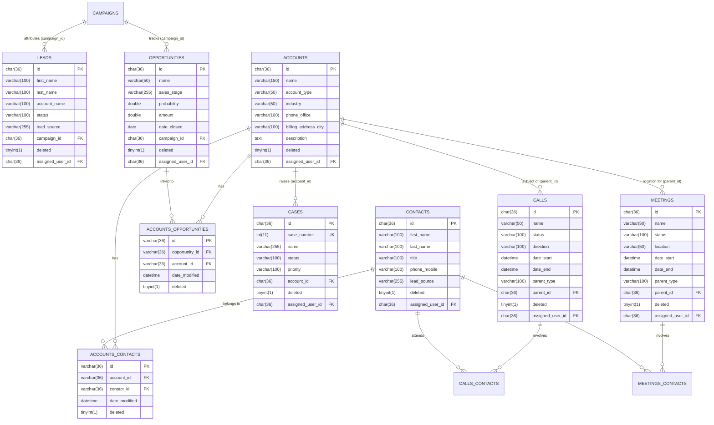

# ARSITEKTUR BASIS DATA & SKEMA RELASIONAL SUITECRM 8

> **Informasi Sistem & Versi Basis Data Terverifikasi:**  
> - **SuiteCRM Core Version:** 8.8.1 (Legacy Schema Engine 7.14.7 / SugarCRM 6.5.25 CE)  
> - **RDBMS Engine:** MariaDB 10.11.11-debian-12-r11 (`utf8mb3 / utf8mb3_general_ci`)  
> - **Studi Kasus:** PT Sumber Kopi Nusantara (B2B Roastery & Mesin Espresso Surabaya)  
> - **Karakteristik Skema:** 100% diekstrak langsung dari query `SHOW CREATE TABLE` MariaDB pada instance kontainer aktif.

---

## 1. Entity-Relationship Diagram (Mermaid ERD)

Berikut adalah diagram relasi entitas inti yang menggerakkan sistem CRM PT Sumber Kopi Nusantara:



---

## 2. Struktur Kolom 12 Tabel Inti (Hasil Ekstraksi Riil MariaDB)

### 2.1 Modul Akun & Kontak (Operational & Collaborative Foundation)
1. **`accounts`**: Menyimpan organisasi/perusahaan klien B2B (misal: *Senja Roastery & Eatery*).
   - Kolom kunci: `id` (char 36 PK), `name` (varchar 150), `account_type` (varchar 50), `industry` (varchar 50), `phone_office` (varchar 100), `billing_address_city` (varchar 100), `billing_address_state` (varchar 100), `description` (text), `deleted` (tinyint 1), `assigned_user_id` (char 36).
2. **`contacts`**: Menyimpan individu perwakilan di perusahaan klien (misal: *Hendra Wijaya - Purchasing Manager*).
   - Kolom kunci: `id` (char 36 PK), `first_name` (varchar 100), `last_name` (varchar 100), `title` (varchar 100), `phone_mobile` (varchar 100), `lead_source` (varchar 255), `deleted` (tinyint 1), `assigned_user_id` (char 36).
3. **`accounts_contacts`**: Tabel perantara relasi banyak-ke-banyak (*many-to-many*).
   - Kolom: `id` (varchar 36 PK), `contact_id` (varchar 36), `account_id` (varchar 36), `date_modified` (datetime), `deleted` (tinyint 1).

### 2.2 Modul Penjualan & Kampanye (Operational CRM)
4. **`campaigns`**: Menyimpan program pemasaran penghasil lead (misal: *Pameran F&B Expo 2026 Surabaya*).
   - Kolom: `id` (char 36 PK), `name` (varchar 50), `status` (varchar 100), `campaign_type` (varchar 100), `budget` (double), `expected_revenue` (double), `start_date` (date), `end_date` (date), `deleted` (tinyint 1).
5. **`leads`**: Prospek mentah sebelum kualifikasi (misal: *Bapak Wahyu - Kopi Kontainer Sidoarjo*).
   - Kolom: `id` (char 36 PK), `first_name` (varchar 100), `last_name` (varchar 100), `account_name` (varchar 100), `lead_source` (varchar 255), `status` (varchar 100), `campaign_id` (char 36 FK), `deleted` (tinyint 1).
6. **`opportunities`**: Transaksi pipeline B2B berulang (misal: paket mesin espresso atau kontrak biji kopi).
   - Kolom: `id` (char 36 PK), `name` (varchar 50), `sales_stage` (varchar 255), `probability` (double), `amount` (double), `date_closed` (date), `lead_source` (varchar 255), `campaign_id` (char 36 FK), `deleted` (tinyint 1), `assigned_user_id` (char 36).
7. **`accounts_opportunities`**: Tabel perantara relasi peluang penjualan ke akun bisnis.
   - Kolom: `id` (varchar 36 PK), `opportunity_id` (varchar 36), `account_id` (varchar 36), `date_modified` (datetime), `deleted` (tinyint 1).

### 2.3 Modul Aktivitas & Layanan Pelanggan (Collaborative CRM)
8. **`cases`**: Tiket gangguan atau permintaan servis purna jual (misal: *Tekanan Steam Wand Turun*).
   - Kolom: `id` (char 36 PK), `case_number` (int 11 AUTO_INCREMENT UNIQUE), `name` (varchar 255), `status` (varchar 100), `priority` (varchar 100), `type` (varchar 255), `account_id` (char 36 FK), `deleted` (tinyint 1), `assigned_user_id` (char 36).
9. **`calls`**: Catatan telepon dan rencana follow-up keluar/masuk.
   - Kolom: `id` (char 36 PK), `name` (varchar 50), `status` (varchar 100), `direction` (varchar 100), `date_start` (datetime), `date_end` (datetime), `parent_type` (varchar 100), `parent_id` (char 36), `deleted` (tinyint 1), `assigned_user_id` (char 36).
10. **`meetings`**: Jadwal tatap muka dan demonstrasi teknis (misal: *Sesi Cupping & Uji Mesin Espresso*).
    - Kolom: `id` (char 36 PK), `name` (varchar 50), `status` (varchar 100), `location` (varchar 50), `date_start` (datetime), `date_end` (datetime), `duration_hours` (int 3), `duration_minutes` (int 2), `parent_type` (varchar 100), `parent_id` (char 36), `deleted` (tinyint 1), `assigned_user_id` (char 36).
11. **`calls_contacts`**: Relasi kehadiran kontak pada agenda telepon.
    - Kolom: `id` (varchar 36 PK), `call_id` (varchar 36), `contact_id` (varchar 36), `deleted` (tinyint 1).
12. **`meetings_contacts`**: Relasi kehadiran peserta kontak pada pertemuan/cupping.
    - Kolom: `id` (varchar 36 PK), `meeting_id` (varchar 36), `contact_id` (varchar 36), `deleted` (tinyint 1).

---

## 3. Karakteristik Spesifik Arsitektur Database SuiteCRM

### 3.1 Primary Key UUID 36 Karakter vs. Integer Auto-Increment
Kecuali kolom `cases.case_number` yang digunakan sebagai nomor tiket manusiawi, hampir seluruh tabel entitas menggunakan `char(36)` UUID (contoh: `ea548251-de60-f8ef-2934-6af2d8b2945a`).
- **Keuntungan Enterprise:** Tidak terjadi tabrakan ID saat dilakukan replikasi database *multi-master*, sinkronisasi offline mobile apps sales, atau migrasi data bertahap.
- **Konsekuensi:** Ukuran indeks B-Tree lebih besar dibanding integer 4-byte standar.

### 3.2 Pola Soft-Delete (`deleted = 0`)
Di SuiteCRM, aksi `Delete` di UI **tidak pernah** menjalankan `DELETE FROM table WHERE id = ...`.
Sistem hanya menjalankan update:
```sql
UPDATE opportunities SET deleted = 1, date_modified = NOW() WHERE id = '...';
```
Semua query bawaan ORM SugarBean selalu menambahkan klausa `WHERE deleted = 0`. Hal ini mencegah hilangnya jejak audit historis transaksi B2B masa lalu.

### 3.3 Relasi Banyak-ke-Banyak (*Many-to-Many*) `accounts_contacts`
Mengapa kontak tidak diberi kolom `account_id` langsung di tabel `contacts`?
- Dalam bisnis B2B riil, seorang pengusaha (misal *Hendra Wijaya*) bisa memiliki peran ganda: sebagai Purchasing Manager di *Senja Roastery & Eatery*, sekaligus komisaris di *Kafe Aksara*.
- Tabel relasi `accounts_contacts` memungkinkan satu individu terhubung ke lebih dari satu badan usaha tanpa duplikasi profil biodata kontak.

### 3.4 Relasi Polimorfik Aktivitas (`parent_type` dan `parent_id`)
Pada tabel `calls` dan `meetings`, perhatikan pasangan kolom:
- `parent_type`: varchar(100) berisi nama modul target (`Accounts`, `Leads`, `Opportunities`, `Cases`).
- `parent_id`: char(36) berisi foreign key ID entitas tersebut.
Ini adalah pola **Polymorphic Association**, memungkinkan modul aktivitas menempel secara dinamis ke modul mana pun di dalam sistem CRM.

---

## 4. Pemisahan Nilai Kunci (Keys) vs. Label (Labels)

Salah satu topik ujian sistem informasi penting: **Database menyimpan KEY teknis, bukan LABEL tampilan visual.**

| Tabel & Kolom di MariaDB | Nilai Tersimpan di DB (*Key*) | Label Ditampilkan di UI (*en_us / id_ID*) | Dropdown DOM di `$app_list_strings` |
| :--- | :--- | :--- | :--- |
| `cases.status` | `Open_New` | **New** | `case_status_dom` |
| `cases.status` | `Open_Assigned` | **Assigned** | `case_status_dom` |
| `cases.priority` | `P1` | **High** | `case_priority_dom` |
| `cases.priority` | `P2` | **Medium** | `case_priority_dom` |
| `opportunities.sales_stage` | `Proposal/Price Quote` | **Proposal/Price Quote** | `sales_stage_dom` |
| `opportunities.sales_stage` | `Closed Won` | **Closed Won** | `sales_stage_dom` |
| `campaigns.campaign_type` | `Web` | **Web** | `campaign_type_dom` |
| `leads.status` | `In Process` | **In Process** | `lead_status_dom` |

### Bukti Query SQL Riil MariaDB:
```sql
SELECT c.case_number, c.name, c.status AS db_key,
       CASE c.status
           WHEN 'Open_New' THEN 'New (Menunggu Respons Teknisi)'
           WHEN 'Open_Assigned' THEN 'Assigned (Teknisi Ditugaskan)'
           ELSE c.status
       END AS ui_label
FROM cases c
WHERE c.deleted = 0;
```
Hasil:
```
+-------------+------------------------------------+---------------+--------------------------------+
| case_number | name                               | db_key        | ui_label                       |
+-------------+------------------------------------+---------------+--------------------------------+
|           1 | [URGENT] Tekanan Steam Wand Turun  | Open_New      | New (Menunggu Respons Teknisi) |
|           2 | Jadwal Kalibrasi Mesin Kuartal 1   | Open_Assigned | Assigned (Teknisi Ditugaskan)  |
+-------------+------------------------------------+---------------+--------------------------------+
```

---

## 5. Perilaku Kustomisasi Studio (`<module>_cstm`)

Saat pengguna atau administrator menambahkan kolom kustom melalui menu **Admin → Studio** (seperti yang dilakukan pada Live Demo Act 4 menambahkan field dropdown `customer_tier_c`):

1. SuiteCRM **tidak mengubah skema tabel bawaan** `accounts`.
2. SuiteCRM otomatis membuat tabel satelit bernama `accounts_cstm`:
   ```sql
   CREATE TABLE accounts_cstm (
       id_c char(36) NOT NULL,
       customer_tier_c varchar(100) DEFAULT 'Regular',
       PRIMARY KEY (id_c)
   );
   ```
3. Setiap kali SugarBean membaca akun, sistem melakukan `LEFT JOIN accounts_cstm ON accounts.id = accounts_cstm.id_c`.
4. **Alasan Desain Software:** Menjamin upgrade versi kernel SuiteCRM di masa depan tidak akan menimpa atau merusak integritas field kustom lokal perusahaan.

